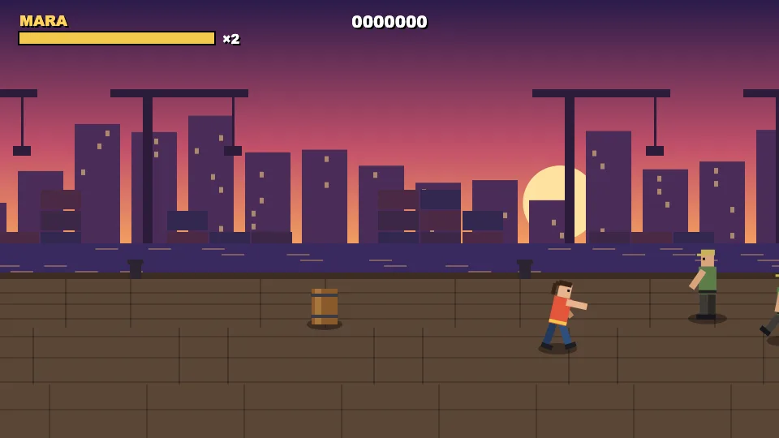

# Saltline Brawl

An original side-scrolling beat-'em-up for the browser. A ferry mechanic fights a smuggler crew across Pier Nine at dusk and faces the Harbormaster.

**Play:** https://smashi.app/arcade/saltline-brawl-fable/
**Build page:** https://smashi.app/games/cadillacs-and-dinosaurs/saltline-brawl-fable/

## Controls

| Action  | Keys                 |
|---------|----------------------|
| Move    | Arrows / WASD        |
| Attack  | J / Z (tap ×3 for a combo, in the air for a jump kick) |
| Jump    | K / X / Space        |
| Special | L / C (costs health when it lands) |
| Start   | Enter                |
| Pause   | P                    |

## Build

- Prompt: "Create demo version of the Cadillacs and Dinosaurs game."
- Model: Claude Fable 5.2 (Medium reasoning effort)
- Harness: Claude Code
- Time to build: 7 min 26 s

Plain HTML5 canvas and vanilla JavaScript with no dependencies: `index.html`, the engine in `src/game.js`, and the enemy decision rule in `src/ai.js`. All art is drawn in code and the sound effects are synthesized with WebAudio. Serve the folder statically or open `index.html` in a browser.

Saltline Brawl is an original game in the beat-'em-up genre. It does not use characters, art, music or levels from any existing game.
